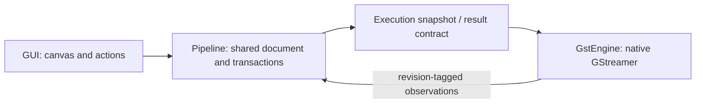

<p align="center">
  
</p>

<p align="center">
  <b>Build GStreamer and DeepStream media pipelines by clicking, then run them as one command or as a single GStreamer element.</b>
</p>

> **Status: early development.** The `dev-zero` branch reorganizes the application into GUI, Pipeline and GstEngine. Hardware support must be backed by device-specific test results; ARM builds alone do not demonstrate Jetson support.

## What it is

You draw a media pipeline instead of writing it. Everything starts at an output (a *src pad*): click a free pad, pick an element that fits, set its properties, and the pipeline is checked right away by really building it with GStreamer. The result is a small `.conf` file.

- **No hand-written C and no `gst-launch` strings.** The tools build the pipeline with the GStreamer API.
- **Nothing is special-cased per element.** Elements, properties, pads and caps all come from GStreamer itself, so the elements your system has (including DeepStream's `nv*` elements) are the elements you get. The one exception is `queue`, which has a shortcut because pipelines need it so often.
- **Run it your way:** `gps-run pipeline.conf`, or let the plugin turn a `.conf` into a normal GStreamer element and use it in `gst-launch-1.0` with its exposed parameters.

## Parts

| | |
|---|---|
| `gstpipestudio` | The Qt 6 window: canvas, drawer for picking elements and setting properties, validation. |
| `gps-inspect` | Lists the elements GStreamer has and describes them (properties, pads, caps) as JSON. |
| `gps-update` | Builds a pipeline from a `.conf`, runs it just far enough to read every pad's caps, and reports them. |
| `gps-run` | Runs a finished `.conf`. |
| `libgstgpsconf` | A GStreamer plugin: every `.conf` in `GPS_PIPELINE_PATH` becomes an element without pads. |

## Architecture



[Architecture and class relationships](docs/architecture/README.md) · [Build, test and release](docs/development/README.md) · [Contributing](CONTRIBUTING.md)

## Requirements

- Ubuntu 20.04, 22.04 or 24.04 (x86-64; ARM is planned).
- GStreamer **1.16 or newer** with the plugins you want to use. DeepStream is optional and is found through GStreamer.
- Building from source: a C++17 compiler, CMake 3.16, Ninja, the GStreamer development packages (`libgstreamer1.0-dev`, `libgstreamer-plugins-base1.0-dev`) and Qt 6.8. The planned `.deb` packages will bring their own Qt.

## Build from source

```bash
cmake -S gstpipestudio -B build -G Ninja -DCMAKE_PREFIX_PATH=/path/to/Qt/6.8.3/gcc_64
cmake --build build
ctest --test-dir build        # CMake 3.20 or newer; older: cd build && ctest
build/bin/gstpipestudio
```

Run a saved pipeline, or use it as a GStreamer element:

```bash
build/bin/gps-run my_pipeline.conf
GST_PLUGIN_PATH=build/lib/gstreamer-1.0 GPS_PIPELINE_PATH=. gst-launch-1.0 my_pipeline
```

## Something wrong?

The window has **Help ▸ Request support…**. It opens a pre-filled issue on GitHub with your system and GStreamer information and the pads that were being linked (home folders and user names are removed). You read it, add what you like and press submit yourself.

## License

[MIT](LICENSE). GstPipeStudio uses GStreamer (LGPL) and Qt (LGPLv3) as separate libraries.
