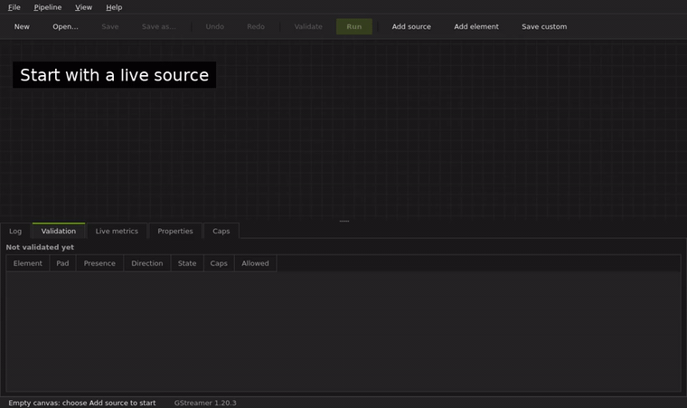
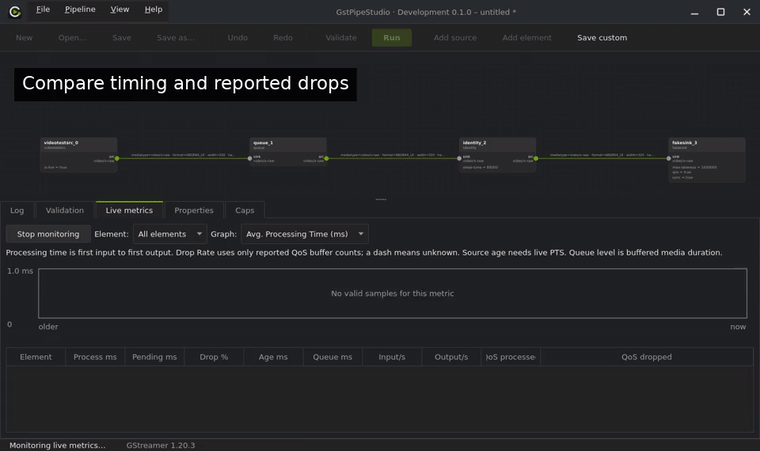

  

<b>Build, inspect and understand GStreamer pipelines visually.</b>

  <a href="https://github.com/mevlt01001/GstPipeStudio/releases">Download</a> ·
  <a href="examples/monitoring/README.md">Try an example</a> ·
  <a href="https://github.com/mevlt01001/GstPipeStudio/issues">Report a bug / request a feature</a> ·
  <a href="CONTRIBUTING.md">Contribute</a>

> Early development. Camera, GPU and DeepStream compatibility depends on your plugins and hardware. Hardware test reports are welcome.

## From an idea to a running pipeline

  

| Build | Understand | Reuse |
|---|---|---|
| Add elements from your GStreamer installation; connect pads and edit properties. | Inspect negotiated caps, processing time, buffer age and reported drops across elements. | Import a gst-launch description, save a `.conf`, and run it again with `gps-run`. |

## Get started

**New users:** [step-by-step installation and Docker guide](docs/install.md).

1. Download the `.deb` matching your Ubuntu version and processor from [Releases](https://github.com/mevlt01001/GstPipeStudio/releases).
2. Install it with `sudo apt install ./GstPipeStudio-22.04-x86_64.deb` (replace the filename with your download).
3. Open **GstPipeStudio**, add a source, then drag from its output pad to connect elements.

Qt is bundled in release packages. GStreamer **1.16+** and the plugins your pipeline needs must be installed. For a camera-free first run, open an [example pipeline](examples/monitoring/README.md).

**Already have a pipeline?** Use **File → Import gst-launch pipeline…** and paste its description. Import briefly probes devices; check validation before running. Import does not attach to another process by pipeline name.

## See where time and buffers go

  

Open **View → Live metrics → Start monitoring**. Every element shows processing time, age and Drop Rate. The graph compares all elements; choose one for detail. A dash means the measurement is unavailable. Drop Rate requires QoS-reported buffer counts; it is not inferred from input/output differences.

**Small conveniences:** reset properties to defaults, undo graph edits, copy one or several elements, arrange the graph, and enable **View → Move connected elements together**. Hover a value control for 500 ms before using the wheel to edit it.

## Help improve it

Use **Help → Request support…** to prepare an issue with environment details. Review it before submitting. **Help → About** shows your app version, build channel, commit, runtime and executable location.

We especially welcome reproducible bugs, hardware results and improvements to element discovery. [Contribution guide](CONTRIBUTING.md) · [Build and test](docs/development/README.md) · [Architecture](docs/architecture/README.md).

Development builds are labelled **Development** and use separate settings from the installed release.

[Support](SUPPORT.md) · [Community conduct](CODE_OF_CONDUCT.md) · [Security](SECURITY.md)

[MIT](LICENSE). GStreamer and Qt remain separately licensed libraries.
