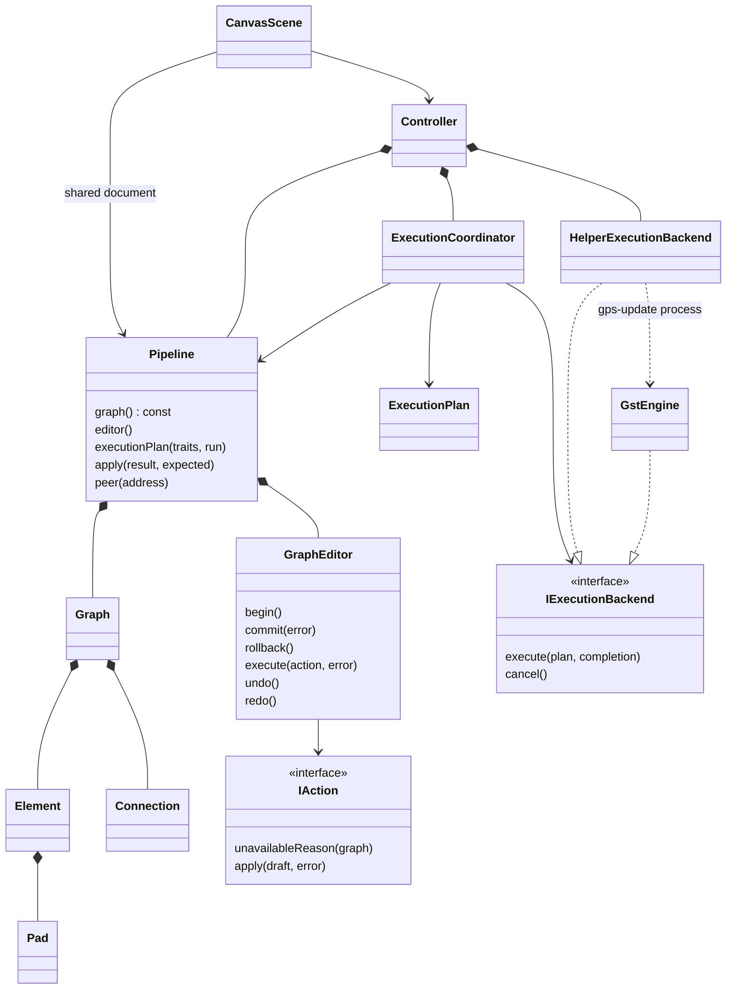

# GstPipeStudio architecture (dev-zero)

The application has three product units. `gstpipestudio/main.cpp` constructs the GUI controller and main window. The controller composes one `gps::Pipeline`, the process backend and an execution coordinator.

| Unit | Target | Responsibility |
|---|---|---|
| `gstpipestudio/Pipeline` | `GstPipeStudio::Pipeline` / `gps_pipeline` | Authored graph, pad descriptors, transactions, history, discovery and execution contracts. No Qt or GStreamer. |
| `gstpipestudio/GUI` | `GstPipeStudio::GUI` / `gps_gui` | Canvas, interaction, catalog/property panels and process transport. Depends on Pipeline and Qt. |
| `gstpipestudio/GstEngine` | `GstPipeStudio::GstEngine` / `gps_gstengine` | Native factory inspection, graph construction, pad binding, preview and execution. Depends on Pipeline and GStreamer. |

The CLI tools and the `gpsconf` plugin are entrypoints into these units. They are not additional editable graph models.

`gps-monitor` is an optional run-scoped telemetry entrypoint. `TelemetrySampler` in GstEngine observes authored pads and emits interval samples to the Qt canvas and monitoring panel. Samples never enter Graph or undo history. One generic state machine per element opens on the first sink buffer and closes on the first src buffer; completed intervals yield Avg. Processing Time and an open interval yields pending time. QoS buffer-unit processed/dropped counter deltas yield Drop Rate only when reported; missing evidence stays unknown. Source age is computed from buffer PTS after SEGMENT conversion and the pipeline clock only for live sources. Queue level comes from buffered media duration. Input/output counts are separate and never treated as a universal loss ratio.

`gps-import` runs in a separate process. GstEngine uses `gst_parse_launch`, optionally probes for dynamic pads, then reads native element factories, nondefault writable properties and pad peers into a `Graph`. Controller installs that graph as a new unsaved Pipeline document and validates it through the usual execution path. The importer has no access to `GstPipeline*` owned by another process; an application must supply a launch description for this path.

## Actual ownership and data flow

`Graph` is a value object used for a transaction draft, persistence and an execution snapshot. `Pipeline::graph()` exposes the committed graph as const. There is no second pointer-based Pipeline model and no GUI-owned undo stack. `GraphEditor` is the mutation gateway. Temporary draft and snapshot copies are deliberate isolation, not independently editable application states.

Element identities are the existing unique names (`factory_N`) so `.conf` version 1 remains compatible. IDs are not recycled by undo. Element and pad addresses must not be retained across a commit. Connections store endpoint identities; `Pipeline::peer()` resolves both directions from one edge record. Element-owned pad descriptors are refreshed from catalog templates and current observations. Dynamic observations and negotiated caps are not serialized as authored decisions.

The implementation uses value-owned records rather than the proposal's optional `unique_ptr` store. This makes transactional copy/rollback explicit and keeps pointers out of asynchronous execution. If graph size warrants structural sharing later, it can be introduced behind Pipeline without changing GUI actions.

## Editing

`IAction` separates availability and application. `MoveElementsAction`, `DisconnectAction` and `InsertFragmentAction` demonstrate reusable actions. `EditAction` adapts small domain operations. Existing compound GUI workflows use `begin/commit/rollback` around the same GraphEditor; they never modify the committed graph directly.

A successful transaction validates graph invariants, records one history entry, clears redo and advances the document revision. A refused or throwing action discards its draft and preserves redo. History is bounded to 64 entries. Undo/redo also advance revisions, preventing late results from matching a restored but newer document.

Insertion requires a connected selection and unambiguous boundary ports. It does not invent internal links between disconnected selected elements. Explicitly use Connect selected first. A failed insertion preserves the original edge and history. Source-only or sink-only fragments retain the existing one-sided splice behavior; ambiguous multi-port insertion is refused with a reason.

The engine uses source-reachable graph components; disconnected work stays on the canvas and in the saved document. Cycles and duplicate pad connections are rejected by editing rules. Runtime completeness and plugin availability remain separate concerns.

## Execution and observations

The coordinator produces an immutable execution graph with an execution revision and run ID. A backend completes once on the owner's thread. The GUI adapter writes a temporary `.conf`, runs `gps-update`, translates the result and removes the temporary file. The native backend builds that snapshot through `Builder`; `session.cpp` owns preview/run lifecycle, bus handling and teardown.

Only matching results are applied. Old runs, duplicate completions, results after a graph change and callbacks after coordinator destruction are ignored. Runtime observations cannot create authored elements or trigger another edit. Coordinate/group presentation changes leave the execution revision unchanged.

The GUI coalesces edits over a 35 ms window and supersedes older runs. Canvas and property edits remain available during preview; new/open/save/run wait for a settled document. The process adapter waits for a cancelled helper to exit before launching its replacement, avoiding overlapping device sessions. Explicit cancellation and real playback temporarily block edits.

An explicit capsfilter remains an authored element. A connection's caps choice is stored on that connection; Builder materializes its native capsfilter. Open outputs use the existing temporary preview-end implementation. Synthetic native elements never enter the authored graph. Negotiated caps are media-format observations; they do not expose buffer contents or prove GPU hardware support.

Canvas bounds expand during panning, resizing and dragging. Negative coordinates are supported. Preview completion never rearranges authored positions; automatic add-after placement moves only the newly added element. Qt coordinates remain finite.

## Extension points

- Add an action: implement `IAction` or compose `EditAction`; use GraphEditor and add an atomicity/history test. Wire the existing Controller/Qt action entrypoint to it.
- Add a native capability: inspect registry metadata or specialize a GstEngine policy; preserve the Pipeline execution contract.
- Add GUI presentation: read Pipeline/Controller views and emit actions; no GStreamer objects belong in widgets.
- Change saved data: update `Pipeline/src/conf.cpp` and its round-trip/compatibility tests. Version 1 is unchanged by this migration.

See [development commands](../development/README.md) and the [original proposal](dev-zero.md). This page describes the implementation; the proposal contains future refinements and must not be read as a list of shipped classes.
