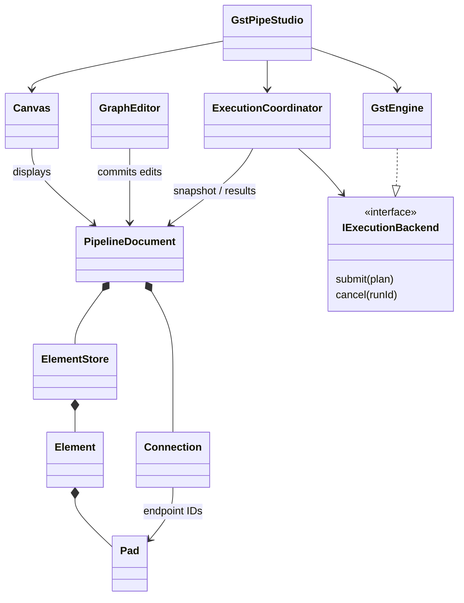
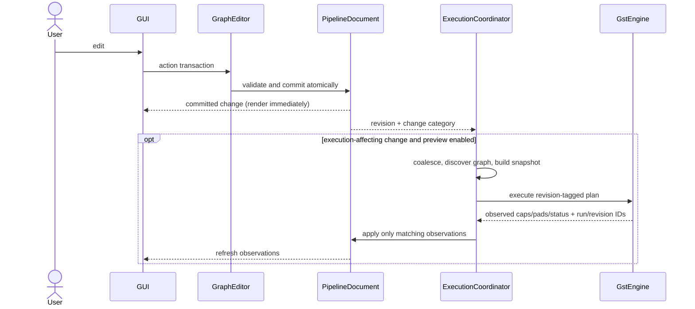

# GstPipeStudio — dev-zero architecture proposal

Status: design proposal, not implemented. This is the first-stage unit tree requested by the maintainer. Implementation starts after discussion of this proposal; main merge requires maintainer review. Three public units: GUI, Pipeline, GstEngine. Names below describe responsibilities; they do not mandate one class or library per leaf.

## Unit tree

```text
GstPipeStudio (composition root: construct, inject, start, shut down)
├── GUI
│   ├── Workspace
│   │   ├── Canvas (reference to the active PipelineDocument)
│   │   ├── Viewport (pan, zoom, dynamically expanding scene)
│   │   ├── Selection (ElementId sets / GraphFragment)
│   │   └── Renderers (element, pad, connection, diagnostics)
│   ├── Interaction
│   │   ├── ActionRegistry (discoverable commands, shortcuts, menus)
│   │   ├── IAction (availability, prepare an edit)
│   │   └── Actions (add, connect, disconnect, move, copy, cut,
│   │       paste, delete, replace, insert fragment, set property/caps)
│   └── Panels (catalog, properties, caps, runtime status)
├── Pipeline
│   ├── Document
│   │   ├── ElementStore (sole owner of all authored elements)
│   │   ├── Element (stable ID, factory, properties, owned pads)
│   │   ├── Pad (stable ID, owner ID, direction, presence)
│   │   ├── Connection (endpoint IDs and optional caps constraint)
│   │   ├── Layout (positions by ElementId)
│   │   └── RuntimeObservations (revision-tagged pads/caps/status)
│   ├── Editing
│   │   ├── GraphEditor (only mutation gateway)
│   │   ├── EditTransaction (atomic changes + inverse changes)
│   │   ├── History (undo/redo of committed transactions)
│   │   └── GraphFragment (selected subgraph + boundary ports)
│   ├── Planning
│   │   ├── SourceIndex (derived, non-owning)
│   │   ├── GraphDiscovery (reachable nodes, edges, branches, joins)
│   │   ├── Validation (editing invariants / execution diagnostics)
│   │   └── ExecutionPlan (immutable revision-tagged graph snapshot)
│   ├── ExecutionCoordinator
│   │   ├── ChangeScheduler (coalesce changes, cancel superseded runs)
│   │   ├── IExecutionBackend (submit, cancel, receive observations)
│   │   └── ResultApplier (revision and element/pad identity checks)
│   └── Persistence (document format, compatibility, load/save)
└── GstEngine (implements IExecutionBackend)
    ├── Catalog (native factory/property/pad-template discovery)
    ├── NativeBuilder (elements, properties, bins, links)
    ├── PadBinding (always, request, dynamic pad lifecycles)
    ├── PreviewCompletion (temporary endpoints for open outputs)
    ├── CapsConstraintLowering (connection constraint → capsfilter)
    ├── RuntimeSession (state transitions, bus, cancellation, teardown)
    ├── Observation (negotiated caps, pad changes, diagnostics)
    └── NativeOwnership (GStreamer references and callback lifetime)
```

## Ownership and dependencies

Shared types are declared in Pipeline and accessible to GUI and GstEngine. They are not process-global mutable objects. One PipelineDocument owns every authored element, including disconnected elements and explicitly added capsfilters. Canvas references that document. SourceIndex is a view used for discovery; it cannot own the only record of elements because disconnected work must survive.

ElementStore may use unique_ptr ownership to keep live element addresses stable. Durable connections, selections, history and async messages use IDs; no raw pointer survives deletion or crosses the backend boundary. Connection is the authoritative edge record; Pad peer access resolves through the document, avoiding duplicate independently writable edge state.

GUI depends on Pipeline's public API. GstEngine depends on Pipeline's execution contract; Pipeline does not depend on concrete GstEngine. GstPipeStudio injects the backend. Preserve process isolation where practical; choose in-process versus helper transport in a migration ADR before implementation. Neither choice changes the snapshot/result contract. GUI owns neither GstElement nor GstPad.



## Editing and action contract

An action evaluates availability with a reason and prepares a transaction. It does not mutate the document directly or run GStreamer. GraphEditor validates and commits one complete change, emits a revision/change category, and History records its inverse. Menus, shortcuts and gestures use the same action. Different action classes specialize behavior without a central switch on every action type. Small data records need no artificial inheritance.

GraphFragment represents one element or a selection. Connectivity alone is insufficient for insertion: its boundary must have an unambiguous compatible input/output pair. Multiple possible boundaries require user selection. The insertion transaction removes the old edge, installs boundary links and preserves internal links; failure leaves the original graph intact. Undo restores the entire operation. Replace is also one transaction (remove/add/reconnect under validated rules), with explicit handling of unsupported properties and ports.

Graph mutation invariants: unique stable identities; valid endpoint ownership; no dangling links; valid direction and pad cardinality. Runtime completeness is not an editing invariant: missing source/sink, unavailable factory, unresolved dynamic pad or incompatible negotiation produces diagnostics, while the user's document remains editable. Cycles are detected and reported; traversal terminates with visited-node tracking and never assumes every graph has a topological order.

## Change and feedback flow



Move/selection/pan/zoom do not rebuild the native pipeline. Topology, properties and caps invalidate execution. Observation updates are not authored edits and do not recursively trigger execution. Incremental live property updates may be introduced after the lifecycle contract is proven; rebuilding a bounded preview session is the simpler initial behavior. Preview is cancellable and time-bounded, with explicit status; running it can activate devices and sources.

Discovery starts from known source nodes and collects an execution graph, not merely a flat ordered list. Branches, joins and pending dynamic/request-pad bindings are preserved. Unreachable authored nodes stay in the document. Source absence yields a diagnostic, not data loss.

## Caps and incomplete graphs

An explicit capsfilter is an ordinary authored Element. A caps constraint set on a connection is stored once on Connection; GstEngine creates its native capsfilter when building the execution graph. Synthetic nodes have mapping back to the authored connection and are never silently persisted as user-created elements.

For open source pads, preview may attach suitable temporary endpoints. Do not attach an unconditional queue/typefind/fakesink chain everywhere. Isolate completion policy and validate it against media types and plugin behavior. Negotiated caps describe observed media format, not sample contents. Show template possibilities, user constraints and observed negotiated caps distinctly; absence of negotiation must not be presented as measured data. Runtime pad removal invalidates observations and bindings safely.

GStreamer supports always, sometimes and request pads; dynamic pads may appear only after data is processed. Therefore native construction cannot be a single unconditional sequential link loop. Reference: https://gstreamer.freedesktop.org/documentation/application-development/basics/pads.html

## Canvas behavior

No user-visible fixed rectangle or hard position clamp. Use expanding scene bounds and a stable world-coordinate model; zoom and panning do not alter authored positions. Qt still uses finite numeric coordinates. Large-coordinate behavior must be verified rather than promising mathematical infinity. Element geometry may refresh when pad observations change; user-authored positions are preserved unless an explicit layout action requests movement.

## Implementation run after design discussion

1. Baseline and inventory: record current behavior/builds and existing file format; map useful existing implementations to the three boundaries. Decide transport, saved-format migration and native minimum API policy in short ADRs.
2. Pipeline vertical slice: owner store, IDs, elements/pads/connections, transactions, change notifications, source discovery. Cover disconnected nodes, atomic insertion, delete/undo and caps constraint persistence.
3. GUI integration: Canvas uses the one document; route existing gestures through actions; implement expanding scene and remove duplicated editable graph state. Demonstrate add/connect/move/group/delete/undo before widening scope.
4. GstEngine integration: immutable plans, cancellation, revision-safe observations, native binding lifecycle, open-output previews and caps lowering. Verify GStreamer 1.16 APIs against 1.16 headers/runtime; newer documentation may show newer APIs.
5. Complete migration: remove old Plan adapters only after behavior and saved-document migration are demonstrated. Publish the actual dependency/UML/action documentation from the resulting structure.
6. Build/test/release: explicit CMake targets GUI/Pipeline/GstEngine and composition executable; documented local/CI commands; pure model, backend contract, CPU integration and Qt interaction tests; optional hardware jobs with honest skips. Test the supported minimum GStreamer 1.16 environment separately from modern versions. Choose CMake minimum before presets. Clean install smoke checks, version consistency, dependency/license inventory, checksums and release notes.
7. Maintainer review: runnable build, short scenario checklist, diagrams, test results and remaining limitations. Ask the maintainer to inspect the application. Merge to main only after their approval; publishing a release is a distinct action.

Each step ends in a buildable/reviewable increment. The first implementation milestone is one element added to a document, a second connected, and the entire edit undone with consistent pad/edge state. Larger features wait for that path.
