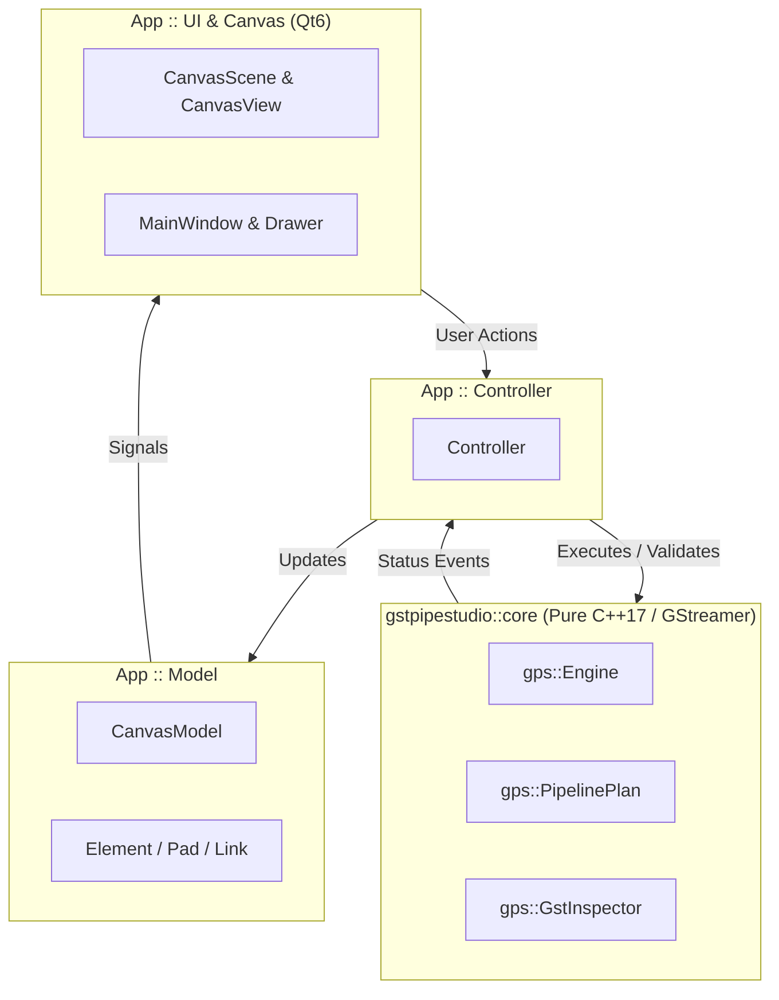
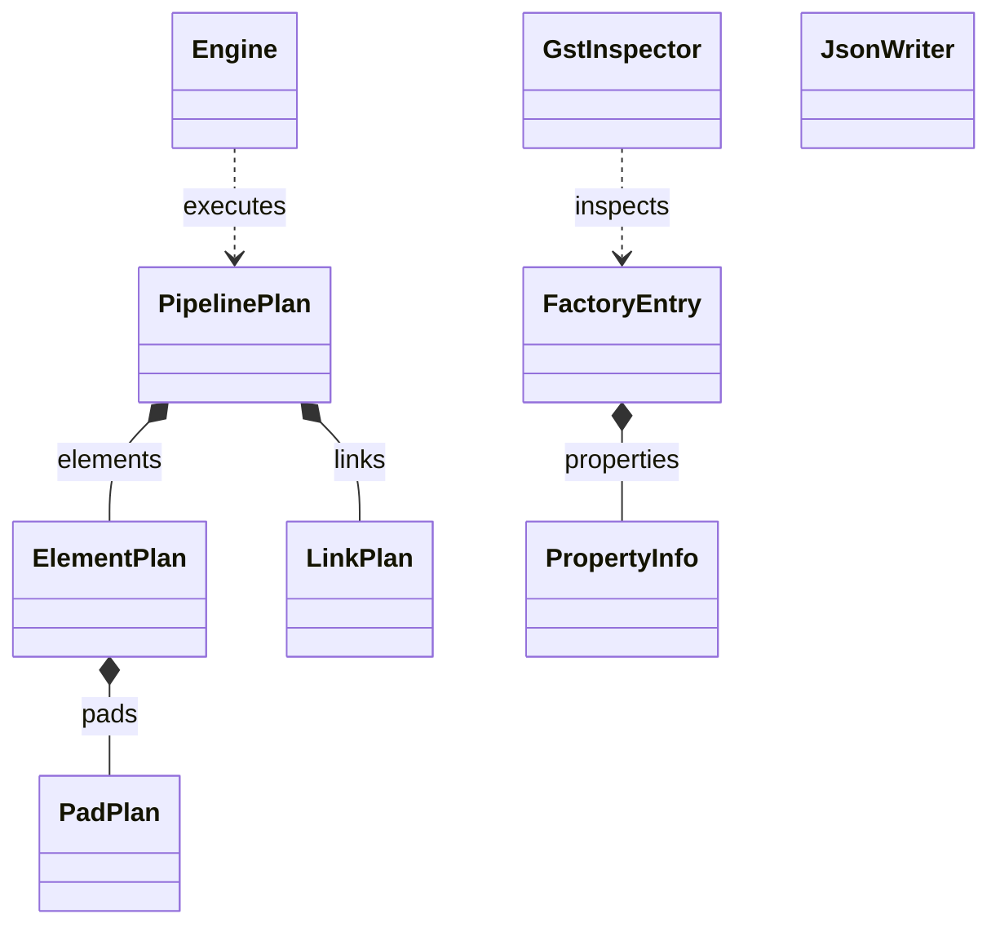
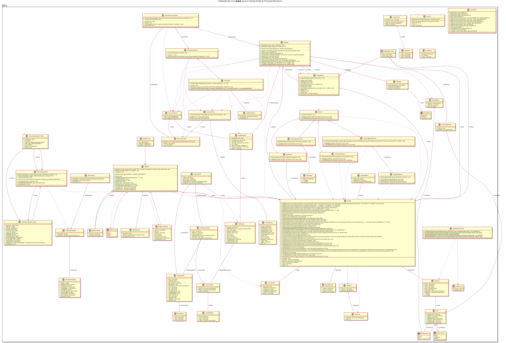
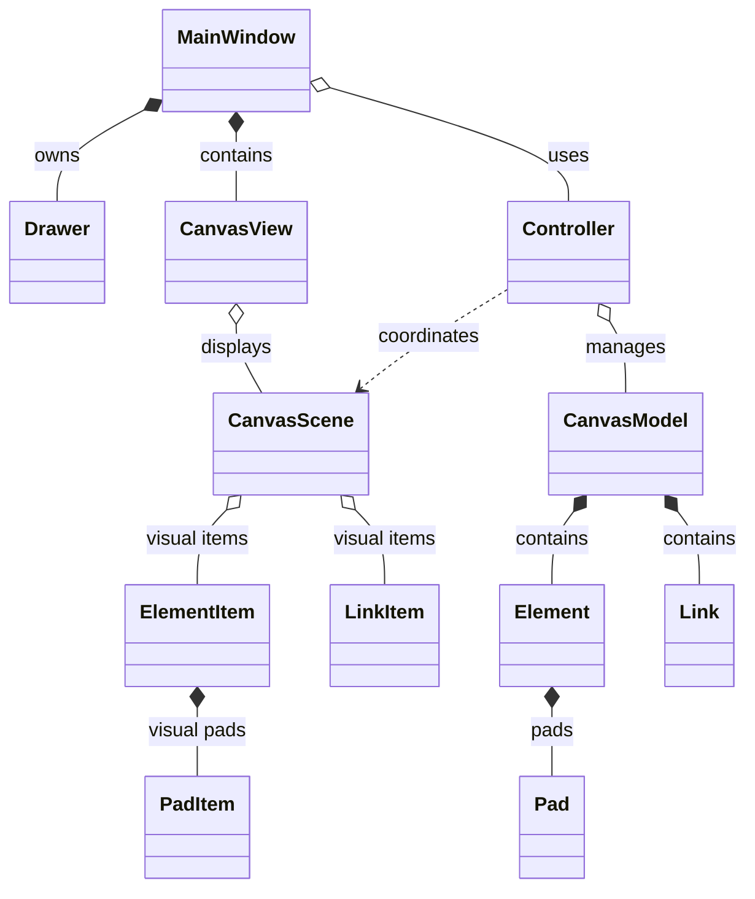
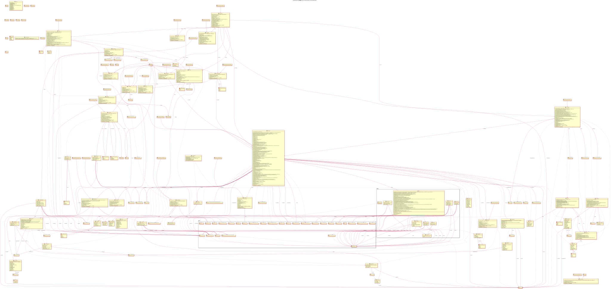

> The checked-in generated diagrams below describe the pre-dev-zero implementation. For the current units, ownership and interfaces, use [the maintained architecture diagram](../../../docs/architecture/README.md). Regenerate these snapshots with the updated `.clang-uml` configuration after building.

# Architecture & Class Diagrams

Automated UML diagrams for **GstPipeStudio**, generated from C++ source via `clang-uml`.

> **Interactive Viewer**: Open [interactive.html](interactive.html) in your browser to pan, zoom, and search across diagrams.

---

## 1. System Architecture

---

## 2. Core Module (Relationships Only)

🔍 <b>Core Module: Detailed Members & Methods (Zoom-In)</b>

- Mermaid source: [core_detailed.mmd](core_detailed.mmd)
- PlantUML source: [core_detailed.puml](core_detailed.puml)

---

## 3. App Module (Relationships Only)

🔍 <b>App Module: Detailed Members & Methods (Zoom-In)</b>

- Mermaid source: [app_detailed.mmd](app_detailed.mmd)
- PlantUML source: [app_detailed.puml](app_detailed.puml)

---

## Generated Files

| Diagram | SVG | Source |
| :--- | :--- | :--- |
| **Directory Packages** | [architecture_overview.svg](architecture_overview.svg) | [architecture_overview.mmd](architecture_overview.mmd) |
| **Core (High-Level)** | [core_overview.svg](core_overview.svg) | [core_overview.mmd](core_overview.mmd) |
| **Core (Detailed)** | [core_detailed.svg](core_detailed.svg) | [core_detailed.mmd](core_detailed.mmd) |
| **App (High-Level)** | [app_overview.svg](app_overview.svg) | [app_overview.mmd](app_overview.mmd) |
| **App (Detailed)** | [app_detailed.svg](app_detailed.svg) | [app_detailed.mmd](app_detailed.mmd) |
